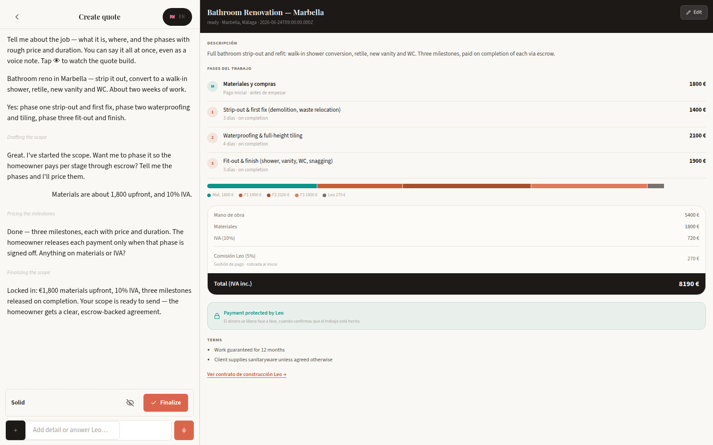

# Leo.casa

Leo.casa is a renovation marketplace for homeowners and contractors, with quotes, project chat and milestone payments.

[Website](https://atelierneyra.com/renovation-marketplace) · [Documentation](https://docs.atelierneyra.com/renovation-marketplace/overview/)



## Run the product walkthrough

Use Node 22.12+ and Python 3.12+:

```sh
git clone https://github.com/latintzar/renovation-marketplace.git
cd renovation-marketplace
make install
make doctor
make build
make dev
```

Open [the local quote](http://127.0.0.1:18260/app/quote/first?reel=set-milestones). The existing product components run with authored sample data. This first result uses the scripted UI, independently of accounts or paid services.

[Getting started](docs/get-started.md) · [Setup and credentials](docs/setup.md) · [Workflows](docs/workflows.md) · [Design decisions](docs/design.md) · [Architecture](docs/architecture.md) · [Source reference](docs/reference.md)

## What is included

| Layer | Included work | Verification |
| --- | --- | --- |
| Product UI | Onboarding, chat, quote editor, original quote document, project phases, proof and release review | Fresh TypeScript/Vite build; actual desktop/phone walkthroughs |
| Payment domain | Financial arithmetic, Checkout, Connect, transfers, refunds, disputes, variations and event handling | Fake provider/repository tests |
| Backend source | Auth, records, quotes, project chat, milestone release, notifications, provider adapters and documents | Selected domain/security tests; live integrations are separate commissioning work |
| Developer database | Five core tables, party-scoped reads and server-owned writes | New, explicitly reconstructed baseline; isolated PG/RLS/restart proof |
| Shared packages | Core, LLM, storage, messaging, voice, full-text, scraping, payments, brand, UI and TypeScript configuration | Source closure and navigation; optional provider requirements retain their own setup |

The original hosted database schema could not be exported from its inactive project. The new developer baseline covers the core quote/project/milestone path and is distinct from that historical schema. [Database guide](docs/database.md) identifies its tables, auth model, tested scope and the extension work still ahead.

The original full backend also expects a compatible Hermes runtime. Its historical vendor checkout was outside the retained tracked tree; this release identifies that dependency explicitly. The scripted first result runs from the included source. [Status and dependencies](docs/status.md).

## Continue the work

Each workflow links its product component, API action, stored records and design rationale. [The agent skill](.agents/skills/install-renovation-marketplace/SKILL.md) follows the same setup path and keeps recipient credentials in a private file outside the checkout.

```sh
make test
make schema-check           # PostgreSQL 16 tools, unprivileged local user
```

[Contributing](docs/contributing.md)

Original code and authored samples use the [MIT licence](LICENSE). Optional dependencies, fonts and integration marks retain their [own terms](THIRD_PARTY.md). Historical operating records, customer uploads, credential-bearing notes and unverified photo/video assets remain outside this release.

[made by atelier neyra](https://atelierneyra.com)
