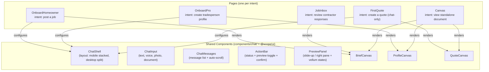
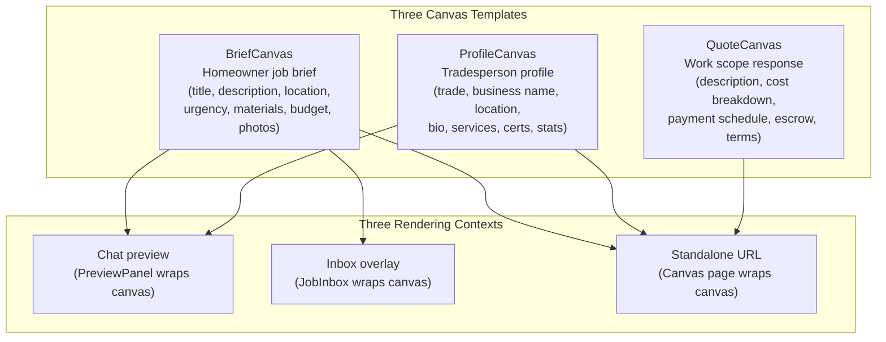
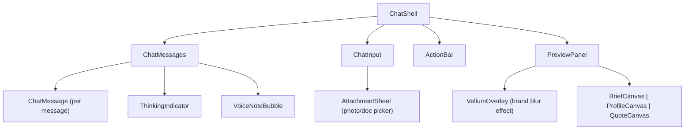
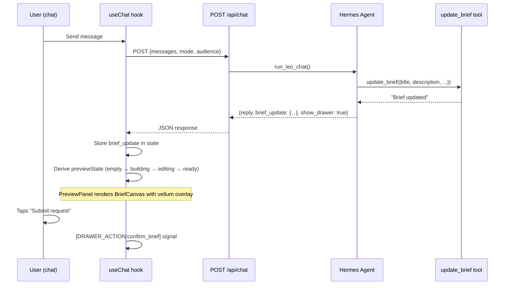

# Web App Architecture

React + Vite + TailwindCSS application. Uses **intent-based architecture**: shared components serve multiple purposes, configured by what the user is trying to do.

## Intent-Based Architecture



**The rule**: editing in `components/`, `hooks/`, or `lib/` = shared code (check all consumers). Editing in `pages/` = one intent (safe to change alone).

## Page Map

All routes are under the `/app` basename.

| Route | Page | Intent | Key components |
|-------|------|--------|----------------|
| `/` | `Login` | Authenticate | Standalone |
| `/dashboard` | `Dashboard` | Home screen | Standalone |
| `/onboard/homeowner` | `OnboardHomeowner` | Homeowner posts a job | ChatShell + BriefCanvas |
| `/onboard/pro` | `OnboardPro` | Tradesperson creates profile | ChatShell + ProfileCanvas |
| `/import/pro` | `ImportPro` | Import tradesperson profile from URL | Progress steps + ProfileCanvas |
| `/quote/create` | `CreateScope` | Tradesperson creates scope of work | ChatShell + QuoteCanvas |
| `/quote/first` | `FirstQuote` | Tradesperson creates a quote (chat-only, editable preview) | ChatShell + EditableQuoteCanvas + LocationPickerModal |
| `/quote/sent/:token` | `QuoteSent` | Confirmation screen after quote is saved | Standalone |
| `/inbox/:token` | `JobInbox` | Homeowner reviews contractor responses | Response list + BriefCanvas overlay |
| `/ops/:token` | `OpsMonitor` | Founder monitors outreach pipeline | Standalone |
| `/canvas/:token` | `Canvas` | View any canvas as standalone URL | BriefCanvas / ProfileCanvas / QuoteCanvas |
| `/auth/callback` | `AuthCallback` | OAuth callback (Google, etc.) | Standalone |
| `/stripe/kyc` | `StripeKyc` | Stripe Connect KYC entry | Standalone |
| `/stripe/complete` | `StripeReturn` | Stripe Connect completion | Standalone |
| `/stripe/refresh` | `StripeRefresh` | Stripe Connect link refresh | Standalone |
| `/settings` | `Settings` | User settings | Standalone |
| `/dev/library` | `ComponentLibrary` | Dev-only: visual component inventory | All shared components with mock data |

## Canvas System

Leo Canvas is the unified document system. A canvas is any structured document Leo produces — a brief, a profile, a scope. It looks the same everywhere.



**Design principle**: The canvas IS the document. Same `BriefCanvas` component renders in the chat, the inbox, and at a standalone URL. Same pixels, different shell.

## Chat Shell Architecture



`ChatShell` supports a `contained` prop for embedding inside other layouts (gallery, previews). When `contained={true}`, it uses relative positioning instead of fixed fullscreen.

## Data Flow: Agent to Canvas



## State Management

No Redux or external state library. State lives in:

| Where | What | Scope |
|-------|------|-------|
| `useChat` hook | Messages, brief/profile data, drawer state, tool activity | Per chat session |
| `useApp` store | Auth state, session info | Global |
| `localStorage` | Phone number, lead_id, locale | Persistent across sessions |
| URL params | `jobId`, `phone`, `profileUrl`, `token` | Entry point context |

## File Structure

```
src/
  pages/                    One file per intent (not shared)
    OnboardHomeowner.tsx        Configures ChatShell for homeowner job posting
    OnboardPro.tsx              Configures ChatShell for tradesperson profile
    ImportPro.tsx               Import tradesperson profile from URL
    CreateScope.tsx             Configures ChatShell for scope creation (older flow)
    FirstQuote.tsx              Create Quote flow — chat-only, editable scope preview, location picker before finalize
    QuoteSent.tsx          Confirmation screen after a quote is saved
    JobInbox.tsx                Contractor response list + brief overlay
    Canvas.tsx                  Standalone canvas viewer (any type)
    OpsMonitor.tsx              Founder outreach dashboard
    AuthCallback.tsx            OAuth callback handler
    StripeKyc.tsx               Stripe Connect KYC entry page
    StripeReturn.tsx            Stripe Connect completion redirect
    StripeRefresh.tsx           Stripe Connect link refresh redirect
    Settings.tsx                User settings
    ComponentLibrary.tsx        Dev-only component inventory
    Dashboard.tsx               Home screen
    Login.tsx                   Authentication
  components/
    chat/                   Shared chat components (all intents use these)
      ChatShell.tsx             Main layout container (accepts headerRight prop for injected header content)
      ChatInput.tsx             Input bar (text, voice, photo, document)
      ChatMessages.tsx          Message list
      ChatMessage.tsx           Single message renderer (respects hidden flag — hidden messages are not rendered)
      ActionBar.tsx             Status + preview toggle + confirm button
      PreviewPanel.tsx          Slide-up / right pane with vellum states
      AttachmentSheet.tsx       Photo/document picker
      ThinkingIndicator.tsx     Typing animation
      VoiceNoteBubble.tsx       Audio playback bubble
    EditableQuoteCanvas.tsx   Editable quote canvas — mirrors QuoteCanvas visually but with pre-filled input fields for title, location, description, line items
    LocationPickerModal.tsx   Full-screen Mapbox location picker — debounced address search, geolocation, terra pin, privacy note
    shared/                 Shared reusable components (cross-page)
      BriefCanvas.tsx           Full canvas implementation (duplicates @scope/ui — kept for local tree-shaking)
      ProfileCanvas.tsx         Full canvas implementation (duplicates @scope/ui — kept for local tree-shaking)
      QuoteCanvas.tsx           Full canvas implementation (duplicates @scope/ui — kept for local tree-shaking)
    JobCard.tsx               Job card component (used in Dashboard)
  hooks/
    useChat.ts              Chat session state + API integration
    useVoiceRecorder.ts     Voice recording with MediaRecorder API
  lib/
    api.ts                  API client, type interfaces (BriefUpdate, ProfileUpdate, etc.)
    analytics.ts            PostHog analytics integration
    supabase.ts             Supabase client (auth, session)
    utils.ts                Utilities (uid, fileToBase64, etc.)
    handoff.ts              WhatsApp handoff link handling
  types.ts                  Shared TypeScript types
  App.tsx                   Route definitions
  index.css                 Global styles + Leo animations
```
