# Architecture

```mermaid
flowchart TB
  UI[React product and shared UI] --> Client[Typed API client]
  Client --> API[FastAPI routes]
  API --> Auth[Supabase JWT identity and project-party gates]
  API --> Records[Business records]
  Records --> DB[PostgreSQL through Supabase REST]
  API --> Pay[Shared payment domain and Stripe adapter]
  API --> Agent[Hermes boundary and product tools]
  Agent --> Model[Recipient model/proxy account]
  API --> Delivery[Configured messaging and document adapters]
```

## Browser

`apps/scope/product/web` contains the signed-in React product. `packages/ui` owns shared components and document types. `packages/brand` owns tokens, typography, logo assets and the original gradient renderer. The original Source Sans3 and Playfair Display fonts are self-hosted with their OFL notices.

The scripted reel intercepts the typed HTTP boundary and owns its sample state. It is a separate presentation layer over the original pages.

## Server

`apps/scope/product/backend/routes` owns product HTTP actions. `records` owns durable application facts; the shared storage package provides generic memory/search engines. `state_machine.py` owns allowed phase/project transitions. The payment package provides typed operations, financial arithmetic, provider abstractions and fake repositories.

Some retained routes still use direct provider-adapter calls alongside shared helpers. The code reference shows the actual boundaries; this release preserves that migration state.

## Identity

The backend verifies Supabase identity. A claimed `contractors.auth_user_id` row identifies a contractor; another authenticated subject resolves as a homeowner. Project actions then check the assigned contractor or homeowner. [Database and auth](database.md).

## Agent runtime

The application-specific persona, tool handlers and orchestration live in `backend/agent`. `packages/messaging/frameworks/hermes.py` is the upstream-runtime boundary. The historical external vendor checkout and its exact pin were not retained in this tracked source. The full connected agent needs a compatible recipient installation and a separate acceptance run.

## Source navigation

[Reference](reference.md) maps real modules, functions, routes and configuration names. The original application source remains under its existing directory names, preserving useful relationships for contributors.
