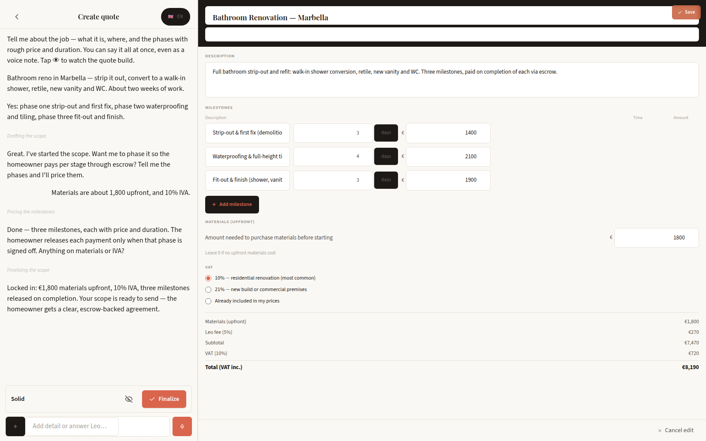

# Design decisions

## Conversation as input

Founder discovery included requesting renovation quotes and talking with tradespeople about how they scope and find work. Descriptions, prices and previous-work photos already travelled through WhatsApp. The product keeps that familiar conversation while giving the agreed work a shared structure.

The public account uses qualitative observations. Participant records and discovery conversations remain with their original private records.

## The editable canvas

Chat carries context; the document carries the agreement. Putting priced phases beside the conversation lets a contractor review the result, adjust it and share a clear record. Editing remains an explicit action rather than a hidden change to a chat transcript.

The full original read-only document was found at source revision 8c4f259a, before a later tracking-page rewrite replaced it with a small placeholder. This release restores that original component with renamed type/export compatibility. [Restoration provenance](../provenance/quote-canvas-restore.json).

## A phase as the unit of approval

Each phase combines its work, amount and state. The review sheet places proof, the contractor's note, payee and release action in one context. This reduces the distance between evaluating the work and authorizing the associated payment.

## Shared project context

The quote token connects document, phases, messages and proof. A shareable quote view and authenticated payment actions have separate boundaries. The backend checks identity and transition state before a release.

## Evidence and implementation

The walkthrough preserves the original components and script structure. Sample attachments are newly authored project records, replacing photo/video files whose redistribution permission was not established. The interface, the payment integration source and a settled payment are distinct forms of evidence. [Verification status](status.md).
