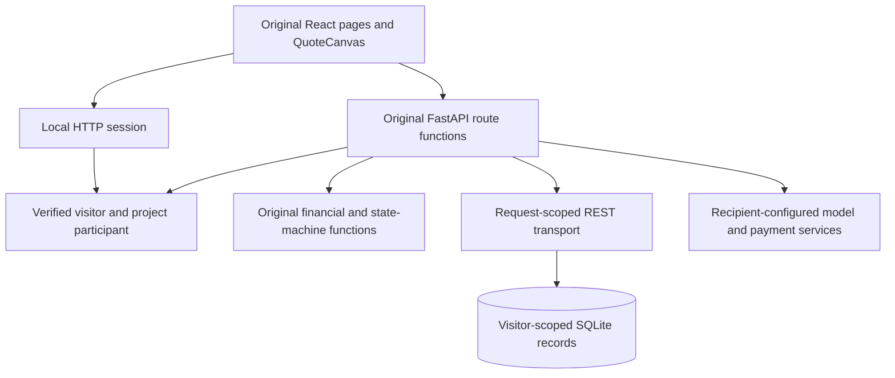

# Native workspace

The local app uses the original React pages, full QuoteCanvas, FastAPI route functions, financial calculations and project-party checks. SQLite stores each visitor’s quote, project messages, proof, variations and notifications. The browser calls those routes over HTTP.

## Start

```sh
make install
make doctor
make build
make dev
```

Open **http://127.0.0.1:18260/app/**. A private local session opens the contractor’s existing job list. The starter contains an editable quote and an authored project with a phase ready for review.

| Try | Entry |
| --- | --- |
| Contractor jobs | `/app/dashboard?local_role=contractor` |
| Edit the saved quote | `/app/quote/first?editToken=sample-quote` |
| Project phases | `/app/project/sample-project` |
| Project messages | `/app/job-chat/sample-project` |
| Homeowner projects | `/app/my-projects?local_role=homeowner` |

Edit and save the quote, reload it, send a project message, or submit phase proof from the job list. Those actions write through the original backend functions. Each visitor’s records remain separate. The role entries select the two participants within that visitor’s own workspace.

The quote uses the retained calculation: €5,400 work + €1,800 materials + €270 service fee + €720 IVA = **€8,190**. Quote updates keep the stored total and phase schedule in step with the editable document. Paid projects use their variation workflow for changes.

## Source flow



| Source | Responsibility |
| --- | --- |
| [native.py](../tools/native.py) | Clean environment, build configuration, private state and loopback server |
| [local server](../apps/scope/product/backend/local_mode/server.py) | Native routers, cookie authority, origin/body checks and service admission |
| [SQL store](../apps/scope/product/backend/local_mode/store.py) | Isolated persistent records and the internal REST row adapter |
| [starter records](../apps/scope/product/backend/local_mode/seed.py) | Authored quote/project inputs, calculated by the original financial module |
| [HTTP factory](../packages/core/src/core/http.py) | Bind the owned storage transport to the current request |
| [local auth client](../apps/scope/product/web/src/lib/localAuth.ts) | Read the real server session through the existing browser auth contract |
| [quote routes](../apps/scope/product/backend/routes/canvas.py) | Read, finalize and update the real quote records |
| [project chat](../apps/scope/product/backend/routes/messages.py) | Verify the sender and persist project messages |
| [phase routes](../apps/scope/product/backend/routes/milestones.py) | Verify project ownership and record submitted evidence |

The local auth client uses an HttpOnly session cookie. The server stores its hash and derives the two participant IDs privately. Public user IDs provide display identity; the cookie provides access authority. The internal REST adapter is reached only by the original route functions. Its table/filter allowlist serves these retained contracts rather than a general SQL endpoint.

The normal Supabase/Stripe/Hermes entrypoint remains at [backend/main.py](../apps/scope/product/backend/main.py). Its ordinary HTTP factory retains the original transport when the local context is unset. Project chat uses HTTP polling in local mode and its original Supabase Realtime transport in configured mode.

## Storage

This new local adapter creates two SQLite tables:

| Table | Columns |
| --- | --- |
| `sessions` | Hashed session ID, participant/role metadata, expiry and last access |
| `records` | Visitor scope, original table name, record ID and JSON document |

The record adapter covers `contractors`, `quotes`, `jobs`, `job_messages`, `milestone_updates`, `variation_orders`, `notifications` and `reviews`. Its composite key and scope index include the visitor on every read and write. SQL parameters bind filter values. Each workspace has a 256,000-byte storage allowance; the service retains up to 256 recent workspaces for 12 hours, with a 128 MiB SQLite ceiling. Requests accept up to 32 KiB.

Default state is `~/.local/state/renovation-marketplace`, outside the checkout. The directory has mode 0700 and the database 0600. A marker identifies this local workspace. Choose another fresh directory with `--state`.

The [Supabase database guide](database.md) describes the separate reconstructed five-table developer baseline, auth/RLS contract and historical recovery limits. The SQLite adapter is a new recipient-owned local path.

## Provider setup

The starter’s project status and phase evidence are authored records for exploring the product. Its payment controls require the recipient’s configured Stripe service. Local service admission holds payment transfers, Checkout, refunds, model jobs, account imports and outbound delivery before provider execution. In-app project messages and notifications use the local database.

For the full connected backend, follow [setup and credentials](setup.md), select the owning account, and save credentials through `tools/configure.py` into its private file. The full schema extensions and compatible historical Hermes runtime retain the acceptance work described in [status](status.md).

Build the configured browser against that backend with:

```sh
.venv/bin/python tools/build.py --env-file /your/private/marketplace.env
```

That original build exports the named public client fields. The server keeps its provider credentials. Its standard callback is `/app/auth/callback`; register that callback with the recipient’s own Supabase project and app origin.

## Mount the same app

```sh
.venv/bin/python tools/native.py build \
  --base-path /apps/renovation-marketplace
.venv/bin/python tools/native.py start \
  --base-path /apps/renovation-marketplace \
  --public-origin https://preview.example.com \
  --port 18790
```

The reverse proxy preserves the prefix and original Host. The exact HTTPS origin enables Secure cookies; their Path is the application prefix, with HttpOnly and SameSite=Lax. [The service unit](../deploy/renovation-marketplace.service) uses a dedicated Unix account, separate state, loopback binding and an operating-system network boundary. Ingress and TLS belong to the host configuration.

Local startup discards ambient provider variables and uses its own HOME/configuration directories. The Python socket fence permits loopback transport. The same repository code and build command serve the public preview and a recipient’s local clone. Historical scripted walkthroughs remain in source under `reel/`; local mode selects the normal app routes and backend.

## Verify

```sh
make test
python tests/browser_native.py
```

The backend tests exercise persisted edits, canonical/legacy field aliases, original sender and project-party logic, phase proof, restart, cross-visitor isolation, origin checks, request bounds and held provider/payment routes. The browser check exercises the normal quote, project and chat pages against a running local server. Playwright and Chromium are optional test dependencies: install `playwright==1.58.0`, then run `python -m playwright install chromium`. `NATIVE_TEST_URL` selects another running origin/prefix; `PLAYWRIGHT_CHROMIUM_EXECUTABLE_PATH` selects an existing Chromium binary.

[made by atelier neyra](https://atelierneyra.com)
