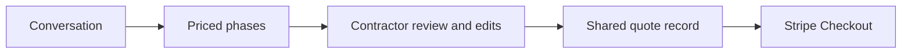
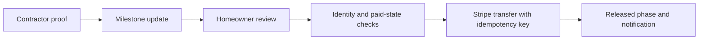
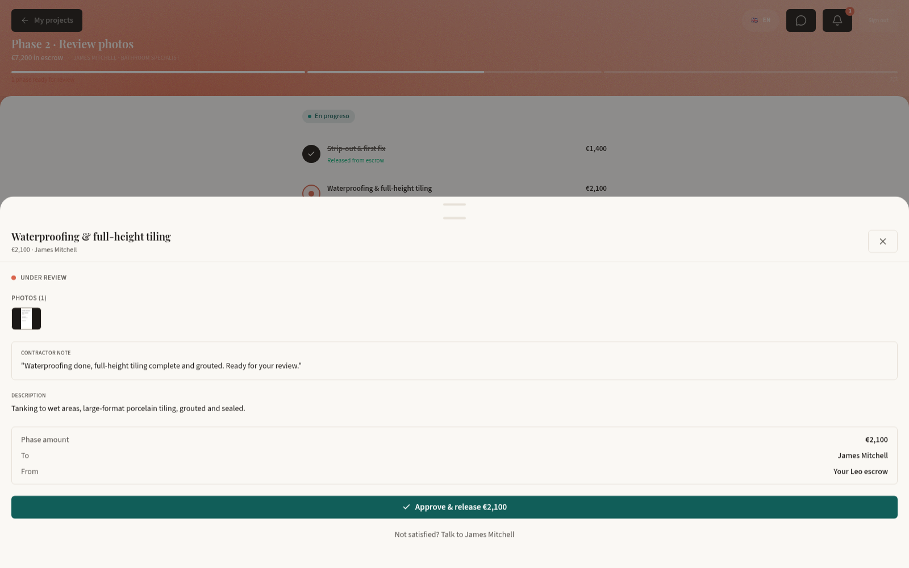

# Workflows

## Brief and quote

A homeowner describes the work in conversation. The contractor's quote carries phases, amounts, durations and terms beside that conversation. The canvas remains editable before sharing.

The native local entry loads the saved quote through the original canvas API. Direct edits persist through its original update route. Connected generation uses the retained agent/tool boundary; the original scripted flow remains a separately selected historical presentation.

Sources: [FirstQuote](../apps/scope/product/web/src/pages/FirstQuote.tsx), [editable canvas](../apps/scope/product/web/src/components/EditableQuoteCanvas.tsx), [original restored document](../packages/ui/src/QuoteCanvas.tsx), [finance](../packages/payments/src/payments/finance.py).

## Milestone review

A contractor submits evidence against a phase. The homeowner sees the work, note, amount and payee together before confirming release.

The API verifies the caller and assigned project, checks the paid state and phase transition, and uses a stable quote/phase idempotency key. This source derivative also bounds negative phase indexes before effects.

Sources: [milestone API](../apps/scope/product/backend/routes/milestones.py), [state machine](../apps/scope/product/backend/state_machine.py), [review sheet](../apps/scope/product/web/src/components/project/MilestoneDetailSheet.tsx).

The local app records proof and in-app notifications through these original functions. Stripe release remains admitted by the recipient-configured payment runtime.

## Project chat

Messages remain attached to the paid project. The source derivative resolves the sender from verified identity and checks project membership for reads and writes. The client-supplied legacy identity fields remain accepted for compatibility; the server determines the recorded participant. Local mode uses cookie authority and HTTP polling; configured mode retains Supabase identity and Realtime.

Sources: [chat API](../apps/scope/product/backend/routes/messages.py), [party matching](../apps/scope/product/backend/project_access.py), [JobChat](../apps/scope/product/web/src/pages/JobChat.tsx).

## Notifications

A notification identifies the recipient, project and phase. Mark-read updates include the current recipient filter. WhatsApp delivery is a separate configured transport; sandbox mode suppresses that delivery.

Source: [notifications](../apps/scope/product/backend/routes/notifications.py).
