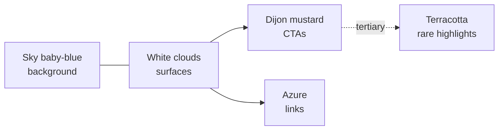

# `vitrina-sky` — baby sky-blue and Dijon honey-mustard

> Look up. The sky is the background. The mustard jar is the CTA.

## Mood

Vitrina's shopper surfaces want to feel **inspirational** and
**daily**. You open the app, a soft baby-blue sky with slow white
clouds drifts in the background, and the actionable bits — buttons,
pay CTAs, basket highlights — are in a warm honey-mustard. It's the
only surface in the Leo universe that puts a sky at the back of the
room rather than paper or charcoal.

Intended audience: `customer` (shoppers). Food & DIY are the beachhead
content categories; the palette is tuned to make recipes and
DIY-project ideas feel tactile and inviting.

## Palette roles

| Role | Colour | Use |
|---|---|---|
| **Primary surface** | baby sky blue `#CEE4FB` → soft white `#F9FBFE` | the sky itself — big panels, hero backgrounds, SkyWithClouds animation |
| **Ink** | deep slate `#1F2A3A` | body text on cloud surfaces |
| **Accent / CTA (Dijon)** | honey-mustard `#D89B2E` with `#8A6116` dark / `#F9E8C2` light | **all** primary buttons, pay CTAs, selected states |
| **Secondary accent (sky)** | azure `#3F7DD6` with `#1F4B96` dark | links, focus rings, small info chips |
| **Tertiary "fun toys"** | warm_drift terracotta `#E07A4D` | rare highlights — a recipe's star ingredient, a special shop badge |
| **Card / paper** | cloud white `#FCFDFE`, subtle border `#E4ECF7` | shop cards, recipe cards, chat bubbles |

The **Dijon is the hero accent**, not the sky. The sky is the room;
the mustard is the lamp. Every primary button in the app is Dijon.

## Mermaid — colour relationships

## The seven slots

| Slot | Value |
|---|---|
| Narrative | this file |
| Palette | [`tokens.py`](../../tokens.py) → `THEMES["vitrina_sky"]` (sky + Dijon + azure + terracotta) |
| Gradient stops | [`gradients.py`](gradients.py) — `blueWhite` airified + `brendan` fallback |
| Illustration voice | [`illustration_style.py`](illustration_style.py) — Dijon accent tint |
| Translucency | `vellum` (unchanged — clouds already do the job) |
| Motion | `quiet` (unchanged — slow cloud drift fits quiet perfectly) |
| Typography | `default` (warm-drift serif; shopper reads like a magazine) |

## Why this exists

1. **Shopper emotional register.** `default` (morning utility) and
   `warm_drift` (evening story) both read as interior paper surfaces.
   Vitrina's shopper surface needs a sky — it's a discovery product;
   looking up, imagining what's out there, is the emotion.
2. **Dijon is the recognisable signal.** Across the six target
   markets (BG/ES/FR/IT/EL/PT) the honey-mustard reads as warm,
   Mediterranean, food-adjacent — but still a single-colour CTA the
   eye snaps to.
3. **Schema pressure-test, round two.** Like `warm_drift`, this
   theme only changes three slots: palette, gradients,
   illustration accent. Motion, translucency, typography all stay at
   canonical values. If adding a sky-and-sun voice required touching
   typography or motion, the schema would be too loose.

## Where it's used

- `apps/vitrina/product/web/` — entire shopper SPA (chat + shops
  tabs). Set via `<html data-theme="vitrina_sky">`.
- `apps/vitrina/product/public/` — marketing landing when we turn
  that on.
- **Not** used by `apps/scope/` or `apps/leo-internal-sales/` — those
  stay on `default` / `warm_drift`.

## Animated background contract

The shopper app's `SkyWithClouds.tsx` background consumes the
`blueWhite` palette with the overrides in `gradients.py`. See
[`apps/vitrina/product/web/src/backgrounds/SkyWithClouds.tsx`](../../../../../../apps/vitrina/product/web/src/backgrounds/SkyWithClouds.tsx).
